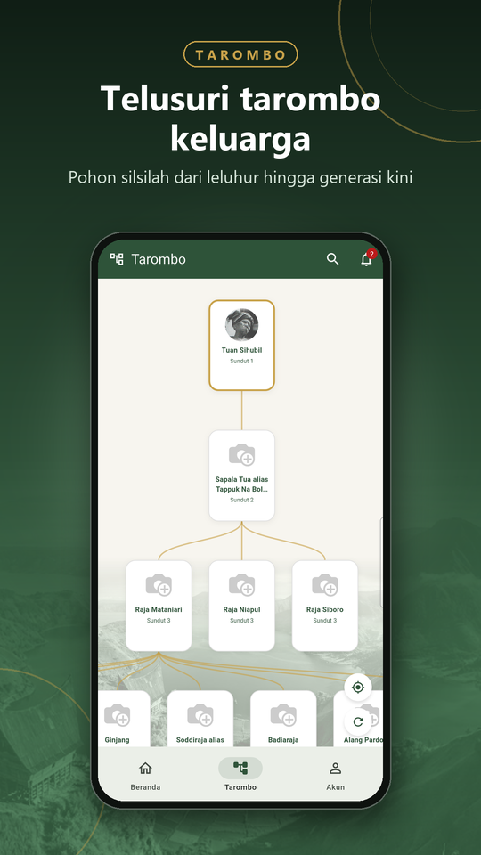
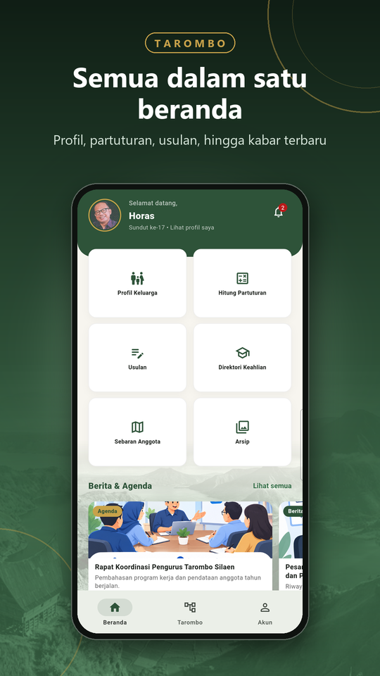
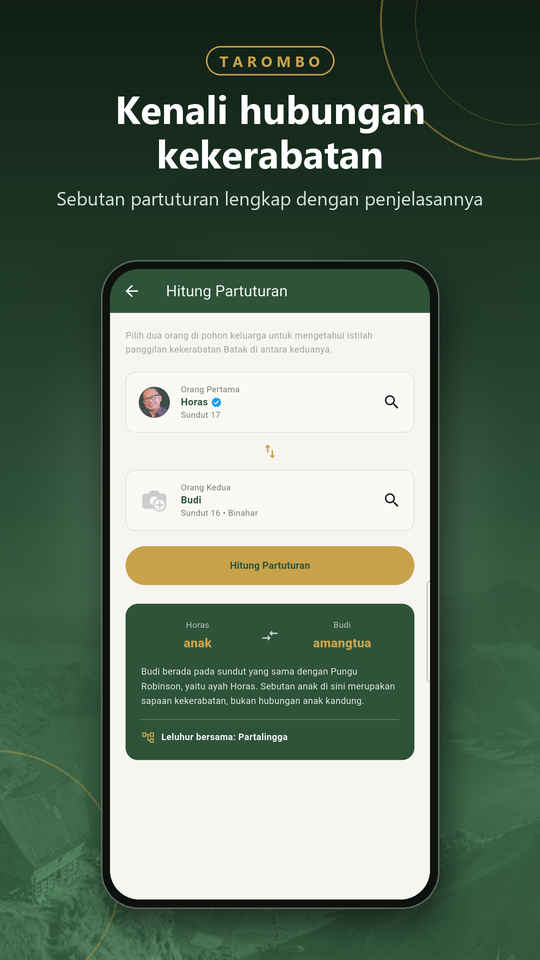
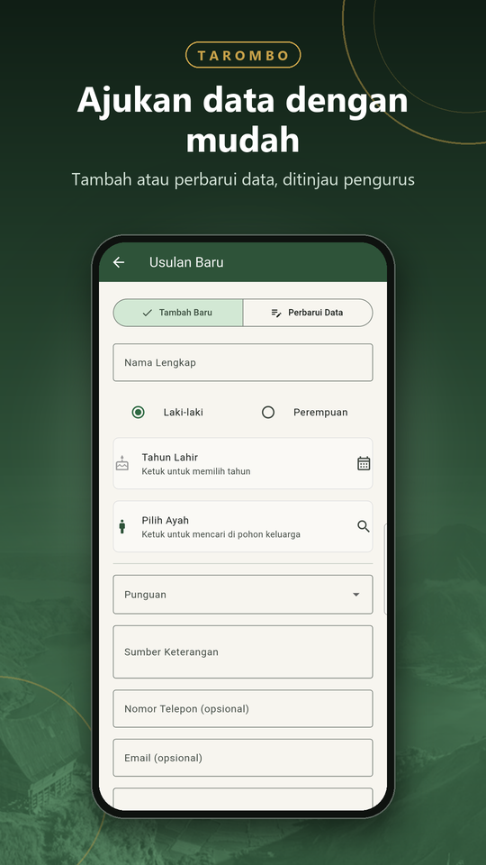
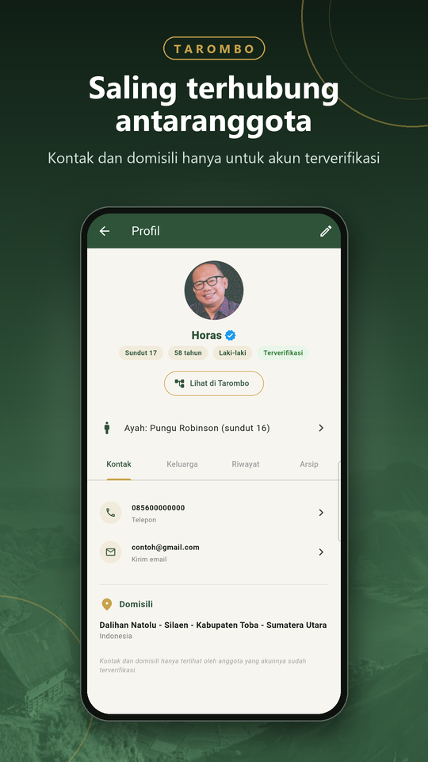
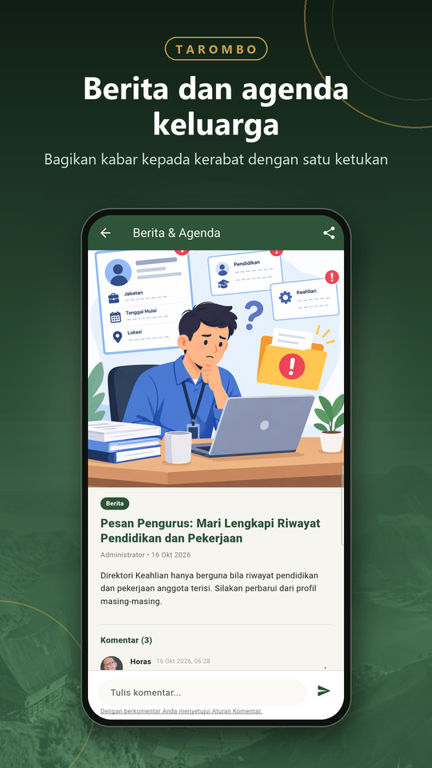
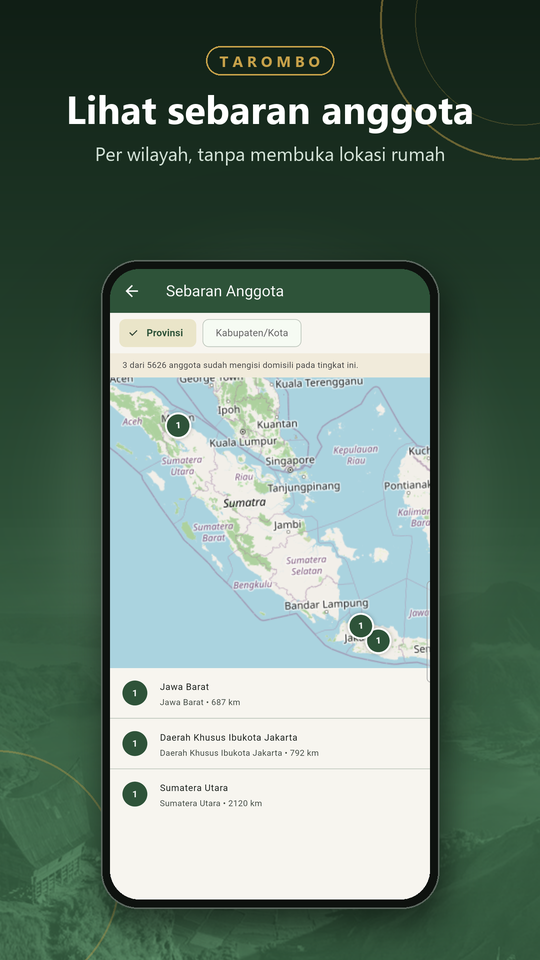
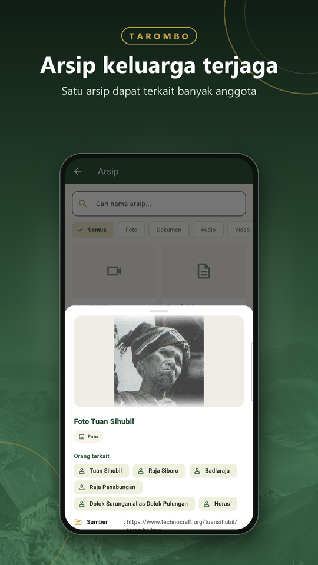

# TaromboMobile 🌳

Aplikasi mobile silsilah keluarga marga **Silaen** yang terhubung ke backend **Odoo 19**. Dibangun dengan Flutter, aplikasi ini memungkinkan anggota menelusuri pohon keluarga, mengenali hubungan kekerabatan adat (partuturan), mengikuti berita dan agenda punguan, mengajukan usulan data, serta mengelola arsip keluarga.

[](https://play.google.com/store/apps/details?id=id.selstudio.tarombo_mobile)

---

## Tampilan Aplikasi

<table>
  <tr>
    <td></td>
    <td></td>
    <td></td>
    <td></td>
  </tr>
  <tr>
    <td></td>
    <td></td>
    <td></td>
    <td></td>
  </tr>
</table>

> Seluruh tangkapan layar memakai data uji.

---

## Fitur Utama

| Fitur | Deskripsi |
|---|---|
| 🔐 **Autentikasi** | Login dengan akun biasa atau Google; sesi disimpan aman (`flutter_secure_storage`) |
| 🌲 **Pohon Tarombo** | Penelusuran silsilah antar generasi (sundut), lengkap dengan marga |
| ✅ **Akun Terverifikasi** | Lencana centang biru untuk anggota yang akunnya sudah diverifikasi pengurus |
| 🧮 **Partuturan** | Hubungan dan sebutan kekerabatan adat antara dua anggota, lengkap dengan penjelasannya |
| 📰 **Berita & Agenda** | Kabar dan jadwal punguan di beranda, bisa dibagikan, dengan komentar (laporkan dan blokir tersedia) |
| 📇 **Kontak & Domisili** | Telepon, email, dan domisili sampai desa/kelurahan; hanya untuk akun terverifikasi |
| 🗺️ **Sebaran Anggota** | Jumlah anggota per provinsi atau kabupaten/kota di peta (`flutter_map`), tanpa lokasi rumah |
| 📝 **Usulan Data** | Ajukan penambahan atau koreksi data untuk ditinjau pengurus, dengan percakapan dua arah |
| 📂 **Arsip Keluarga** | Dokumen, foto, audio, dan video; satu arsip dapat terkait banyak anggota |
| 📋 **Direktori Keahlian** | Cari anggota berdasarkan profesi atau keahlian |
| 🪪 **Klaim Akun & Banding** | Tautkan akun ke nama di pohon; ajukan banding bila nama sudah diklaim akun lain |
| 🔔 **Notifikasi & Masukan** | Notifikasi status pengajuan, berita, dan pesan pengurus; kirim masukan dari menu Akun |

---

## Teknologi & Dependensi

| Kategori | Package |
|---|---|
| State Management | `flutter_riverpod` ^2.6.1 |
| Navigasi | `go_router` ^14.8.1 |
| HTTP Client | `dio` ^5.8.0 |
| Penyimpanan Aman | `flutter_secure_storage` ^9.2.2 |
| Peta & GPS | `flutter_map` ^7.0.2 · `geolocator` ^13.0.2 · `latlong2` ^0.9.1 |
| Gambar | `image_picker` ^1.1.2 · `cached_network_image` ^3.4.1 |
| Arsip / File | `path_provider` ^2.1.5 · `open_filex` ^4.5.0 |
| Berbagi | `share_plus` |
| Lokalisasi | `flutter_localizations` · `intl` ^0.20.2 |
| Backend | Odoo 19 (modul `tarombo`) via JSON-RPC / REST |

---

## Struktur Proyek

```
lib/
├── main.dart
├── core/
│   ├── config/         # Konfigurasi environment (BASE_URL, DB_NAME, dll.)
│   ├── constants/      # Konstanta aplikasi
│   ├── error/          # Penanganan error global
│   ├── network/        # Dio client & interceptor session
│   ├── router/         # go_router — definisi semua rute
│   └── theme/          # Tema Material (warna, tipografi)
├── features/
│   ├── auth/           # Login, logout, provider autentikasi
│   ├── home/           # Dashboard utama
│   ├── profile/        # Profil & edit data diri
│   ├── partuturan/     # Hubungan kekerabatan adat
│   ├── usulan/         # Pengajuan usulan perubahan data
│   ├── nearby_map/     # Peta kerabat terdekat (GPS)
│   ├── arsip/          # Arsip dokumen keluarga
│   ├── direktori_keahlian/ # Direktori anggota berdasar keahlian
│   ├── klaim/          # Klaim akun baru
│   ├── registration/   # Pendaftaran anggota
│   └── splash/         # Splash screen & pengecekan sesi
└── shared/             # Widget, model, dan utilitas bersama
```

---

## Prasyarat

- **Flutter SDK** `^3.12.2`  
- **Dart SDK** `^3.12.2`  
- **Android SDK** API 21+ (minSdkVersion 21)  
- Akses ke server Odoo dengan modul `tarombo` terinstal

---

## Konfigurasi Environment

Aplikasi menggunakan file JSON untuk konfigurasi environment melalui `--dart-define-from-file`.  
**File ini tidak di-commit ke Git** (sudah ditambahkan ke `.gitignore`).

Buat file berikut di root proyek:

**`env.dev.json`** — Development
```json
{
  "BASE_URL": "https://your-dev-server.com",
  "DB_NAME": "nama_database",
  "IS_PRODUCTION": "false"
}
```

**`env.prod.json`** — Production
```json
{
  "BASE_URL": "https://your-prod-server.com",
  "DB_NAME": "nama_database",
  "IS_PRODUCTION": "true"
}
```

**`env.web.json`** — Web
```json
{
  "BASE_URL": "https://your-server.com",
  "DB_NAME": "nama_database",
  "IS_PRODUCTION": "false"
}
```

---

## Cara Menjalankan

### Menggunakan skrip PowerShell (Windows)

```powershell
# Development (Android/emulator)
.\run_dev.ps1

# Production
.\run_prod.ps1

# Web browser
.\run_web.ps1
```

### Manual

```bash
# Development
flutter run --dart-define-from-file=env.dev.json

# Production
flutter run --dart-define-from-file=env.prod.json

# Web
flutter run -d chrome --dart-define-from-file=env.web.json
```

---

## Build Release

```bash
# Android APK
flutter build apk --dart-define-from-file=env.prod.json --release

# Android App Bundle (untuk Play Store)
flutter build appbundle --dart-define-from-file=env.prod.json --release

# iOS
flutter build ios --dart-define-from-file=env.prod.json --release
```

---

## Instalasi & Setup Awal

```bash
# Clone repository
git clone https://github.com/rofianto507/TaromboMobile.git
cd TaromboMobile

# Install dependensi
flutter pub get

# Buat file environment (lihat bagian Konfigurasi Environment di atas)

# Jalankan aplikasi
flutter run --dart-define-from-file=env.dev.json
```

---

## Launcher Icon

Ikon launcher di-generate menggunakan `flutter_launcher_icons`.  
Untuk regenerasi setelah mengganti aset:

```bash
dart run flutter_launcher_icons
```

Aset ikon ada di `assets/images/`:
- `logo.png` — ikon utama
- `logo_ios.png` — ikon iOS (tanpa alpha channel)
- `logo_foreground.png` — lapisan foreground adaptive icon Android

---

## Backend (Odoo)

Aplikasi ini memerlukan modul **`tarombo`** yang berjalan di server Odoo 19.  
Repository backend: [rofianto507/tarombo](https://github.com/rofianto507/tarombo)

Endpoint autentikasi dihandle melalui controller di `tarombo/controllers/mobile_auth.py`.

---

## Kontribusi

1. Fork repository ini  
2. Buat branch fitur: `git checkout -b fitur/nama-fitur`  
3. Commit perubahan: `git commit -m "feat: deskripsi singkat"`  
4. Push ke branch: `git push origin fitur/nama-fitur`  
5. Buat Pull Request

---

## Lisensi

Proyek ini bersifat privat dan digunakan untuk keperluan internal komunitas marga Silaen.  
© 2025–2026 Sel Studio
